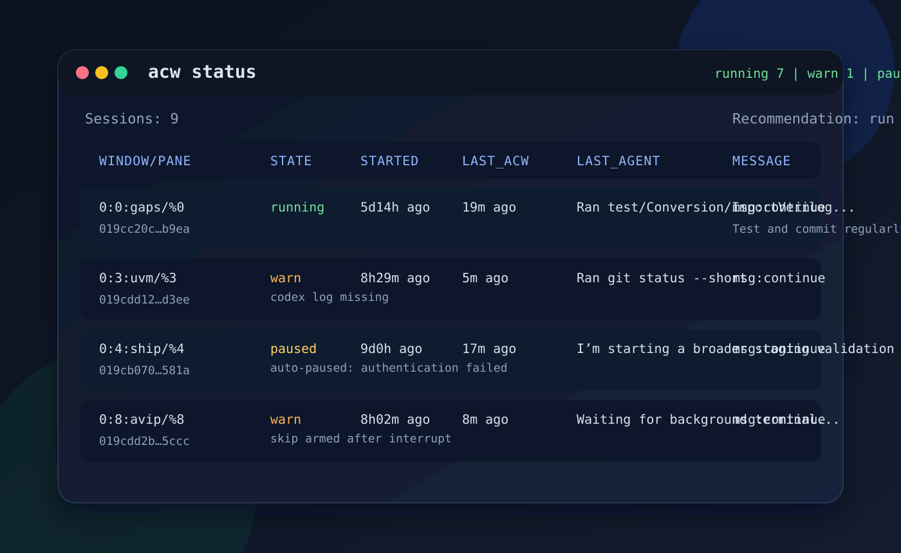

# codex-auto-continue

[](https://github.com/thomasnormal/codex-auto-continue/actions/workflows/ci.yml)
[](LICENSE)

`acw` watches Codex tmux panes and sends your follow-up prompt after each
completed turn.

It is designed for long-running Codex sessions where you want a stable
"continue" loop, but still want to interrupt, inspect, edit the prompt, or
recover from tmux problems without losing control of the pane.

Internally, `acw` now uses one shared daemon per tmux socket plus thread-keyed
managed session state, and that daemon tails `codex-tui.log` once for the
whole tmux socket instead of running one log reader per pane. Mutating
commands talk to that daemon over a local Unix socket, so `start`/`pause`/
`resume`/`restart`/`edit` stream daemon progress directly instead of polling
SQLite for convergence.



Useful project docs:

- [Contributing](CONTRIBUTING.md)
- [Architecture](docs/ARCHITECTURE.md)
- [Security policy](SECURITY.md)

## Requirements

- Linux
- `python3`
- `tmux`
- `pstree`
- Codex CLI

`rich` is optional. If it is installed, `acw status` uses the formatted table;
otherwise it falls back to a plain-text summary.

Installed via `uv`, `rich` is included automatically.

## Install

Install from a local checkout with `uv`:

```bash
uv tool install --editable /path/to/codex-auto-continue
```

From inside the repo:

```bash
uv tool install --editable .
```

After pulling new changes:

```bash
uv tool install --editable --reinstall /path/to/codex-auto-continue
```

To try it without installing:

```bash
uv tool run --from /path/to/codex-auto-continue acw --help
uv tool run --from /path/to/codex-auto-continue codex-team --help
```

## Quick Start

1. Start Codex in a tmux pane.

```bash
codex
```

2. Check that `acw` can see the pane and thread.

```bash
acw doctor
```

3. Start the watcher from any shell attached to the same tmux server.

```bash
acw start uvm
acw start %6
acw start 2
```

`start` accepts a pane id (`%6`), window index (`2`), `session:window`
(`0:2`), or exact tmux window name (`uvm`).

4. Watch the control panel.

```bash
acw
```

If thread discovery is not ready yet, `start` fails instead of guessing.
If you already know the Codex thread id, pass it explicitly:

```bash
acw start uvm 019cb235-bc2c-7920-8832-f2d5656fead8
```

## Everyday Commands

```text
acw                  Show status
acw status --details Show full managed-session details
acw start <target>   Start managing a pane
acw stop [target]    Stop one managed session or all managed sessions, and forget saved session state
acw pause [target]   Pause one managed session or all managed sessions
acw resume [target]  Resume one or more paused managed sessions, or all paused managed sessions
acw restart [target] Restart one managed session or all managed sessions
acw edit <target>    Edit the stored continue prompt, then restart
acw repair [target]  Inspect or apply safe live-state repairs
acw doctor [target]  Diagnose tmux, auth, pane, and runtime state
acw cleanup          Remove dead saved sessions and stale daemon/runtime rows
```

For the all-managed-session operations, use the no-target forms:

```bash
acw pause
acw resume
acw restart
```

`resume` restarts paused managed sessions from the current pane/thread state
instead of thawing an old reader in place. That avoids replaying buffered
Codex log history after a long pause.

`stop` is the destructive "stop managing this session" operation. It removes
the saved session row from `~/.codex/acw_state.sqlite` so the row disappears from `acw`
status immediately. Use `pause` if you plan to resume the same managed session later.

`acw status` only shows managed sessions now. A random live Codex pane with no
saved `acw` session is ignored instead of being reported as an invariant error.

`resume` also accepts multiple explicit targets:

```bash
acw resume formal aot
```

For a single target, `acw restart <target> --restart-codex` also relaunches
Codex in that pane with `codex resume <thread-id>` before restarting the
runtime. This is the same-session restart path when the pane needs a fresh
Codex process, not just a fresh runtime.

`acw restart` with no target now also recovers dead managed sessions whose Codex panes
are still live. It restarts from the saved thread/message state instead of
requiring a fresh `acw start`.

`repair` is the live-state recovery workflow. With no target, `acw repair`
defaults to a dry run and shows safe automatic repairs plus manual blockers
without touching anything. Use `acw repair <target>` for one managed pane, or
`acw repair --all` to apply the safe repairs across all managed panes.

`cleanup` is intentionally separate from `repair`: it only removes dead saved
session rows and stale daemon/runtime artifacts. It does not
try to fix live pane/session/thread mismatches.

## Continue Message

If you do not pass `--message`, `acw start` opens `$EDITOR` so you can write a
multi-line continue prompt. An empty message cancels the start.

Examples:

```bash
acw start %0 --message "continue and focus on tests"
acw start tests
acw resume formal aot
acw restart bugs --restart-codex
acw edit tests
```

## codex-team

`codex-team` is a separate tmux coordination tool built on the same tmux/socket
and Codex-thread plumbing as `acw`.

Run it from a single-pane tmux window:

```bash
codex-team 3
```

That keeps the current pane as the leader, creates three worker panes
(`agent1`, `agent2`, `agent3`), launches Codex in each pane, and starts a
background monitor for that window.

The leader gets an initial prompt telling it to delegate work with tags like:

```text
<message to="agent1">investigate the failing parser tests</message>
```

The monitor sends the inner text to the named worker pane. When the worker
finishes a turn, the monitor routes the worker's latest reply back to the
leader as:

```text
<reply from="agent1">...</reply>
```

Useful commands:

```text
codex-team <n>  Create one leader plus n workers in the current window
codex-team status
codex-team stop
```

`codex-team` currently requires a single-pane tmux window when you create the
team, and worker names are fixed to `agent1`, `agent2`, and so on.

## Status And Health

`acw status` is the main control panel. It shows:

- the live tmux window and pane
- whether the managed session runtime is `running`, `warn`, `paused`, `error`, or `dead`
- when the Codex thread started
- when `acw` last sent a continue prompt
- recent visible agent output from the pane
- the stored continue message

It also flags invariant errors directly when the pane, managed session runtime,
Codex thread, and saved session state stop matching 1:1. `acw` no longer
silently merges those mismatches into a single “best guess” row.

Use:

```bash
acw status --details
```

to see `HEALTH_DETAIL`, state references, watch logs, and the last recorded
event for each managed session.

When the summary table shows a degraded watcher, `acw` prints a follow-up
recommendation such as:

```text
Recommendation: run acw doctor uvm
```

## Interrupts And Failures

User interrupt behavior is intentionally different from real Codex failures.

- Pressing `Escape` in the Codex pane skips exactly one interrupted turn.
- The watcher stays running.
- After you send your next manual prompt, automatic continue resumes on the
  next completed turn.

Real Codex error banners still auto-pause the watcher, including:

- authentication failures
- remote compact task failures
- quota / usage limit failures
- similar pane-visible Codex errors

After fixing the problem in the pane, resume with:

```bash
acw resume <target>
```

If the managed session runtime disappears but the live Codex pane is still present,
`acw status` reports that as an invariant error instead of pretending the
session is merely dead.

## Doctor

`acw doctor` is the first command to run when something looks wrong.

Inside tmux, `acw doctor` with no target checks the current pane. You can also
target a specific watcher or pane:

```bash
acw doctor
acw doctor uvm
acw doctor %6
```

It checks:

- whether `~/.codex` is writable
- whether Codex auth state exists
- whether the tmux server is reachable
- whether the target pane resolves
- whether a Codex thread is discoverable
- what proved that thread identity
- whether a managed session runtime is running, paused, degraded, or dead
- whether the pane, worker, Codex thread, and saved session identity still
  match cleanly

It also prints an explicit recommended next command when appropriate, including
`acw repair ...` when the live invariant model can repair the problem safely,
and it fails instead of guessing when identity is ambiguous.

## Troubleshooting

`acw start <target>` says `could not determine thread_id`

- Codex is not fully started yet in that pane, or it is not a Codex pane.
- Wait for Codex startup to settle, then retry.
- If needed, use `acw doctor <target>` or pass the thread id explicitly.

`acw status` says `dead`

- The managed session runtime is gone and there is no live pane claiming that session.
- Run `acw restart <target>` or `acw start <target>`.

`acw status` says `warn`

- Run `acw doctor <target>`.
- `warn` usually means degraded but still partially functional, not necessarily
  dead.

`acw status` shows `Invariant error`

- Run `acw repair --dry-run` first to inspect the live repair plan.
- If the issue is only dead sessions, run `acw cleanup`.
- Use `acw doctor <target>` when you want provenance and a focused target-level diagnosis.

tmux socket disappeared

- `acw` prints a recovery hint when it can identify the tmux server pid.
- Recreate the socket with the suggested command, for example:

```bash
kill -USR1 1996933
```

## Contributing

See [CONTRIBUTING.md](CONTRIBUTING.md) for the development workflow, fast test
commands, real-Codex test guidance, and tmux safety rules.

## Security

See [SECURITY.md](SECURITY.md) for responsible disclosure guidance.

## How It Works

The watcher reads `~/.codex/log/codex-tui.log` and reacts to Codex completion
events.

Supported completion signals:

- older Codex: `post sampling token usage ... needs_follow_up=false`
- current Codex: `codex_core::tasks: close`

Thread discovery is pane-local. `acw` maps the pane's live Codex process to the
thread id using only direct process-owned evidence: the process tree, Codex's
local SQLite pid mapping, an explicit `codex resume <thread-id>` argv, or the
thread id embedded in the live process's open Codex session files. It does not
guess from cwd, timing, or unrelated global activity.

Canonical watcher/session state is stored under:

```text
~/.codex/acw_state.sqlite
```

The `agents` table holds desired manager state, the `agent_runtimes` table
holds the daemon-owned observed runtime rows for the current tmux scope, and
the `daemon_scopes` table records the shared daemon heartbeat for that tmux
scope. The daemon writes `acw_daemon.<scope>.pid`,
`acw_daemon.<scope>.log`, and per-pane watch logs under `~/.codex/`.
The control socket lives in a short per-user runtime dir such as
`$XDG_RUNTIME_DIR/acw-<uid>/` or `/tmp/acw-<uid>/` so private tmux-socket
tests do not hit the Unix-socket path-length limit.

## Development And Tests

Fast checks:

```bash
bash test/smoke.sh
python3 -m unittest test.test_watchd_unit test.test_logwatch_unit test.test_manager_scenarios
```

Real end-to-end suite:

```bash
bash test/test_rollout_e2e.sh
```

Shared manager scenarios can run on the mock backend, the local tmux backend
(real CLI + tmux + SQLite + daemon with a stub `codex` process), the real
backend, or any comma-separated subset:

```bash
python3 -m unittest test.test_manager_scenarios
ACW_MANAGER_SCENARIO_BACKEND=local AUTO_CONTINUE_RUN_LOCAL_CODEX_TESTS=1 \
  python3 -m unittest test.test_local_codex_integration.LocalCodexManagerScenarioTests
ACW_MANAGER_SCENARIO_BACKEND=real AUTO_CONTINUE_RUN_REAL_CODEX_TESTS=1 \
  python3 -m unittest test.test_real_codex_integration.RealCodexManagerScenarioTests
ACW_MANAGER_SCENARIO_BACKEND=mock,local AUTO_CONTINUE_RUN_LOCAL_CODEX_TESTS=1 \
  python3 -m unittest test.test_manager_scenarios test.test_local_codex_integration
ACW_MANAGER_SCENARIO_BACKEND=all AUTO_CONTINUE_RUN_LOCAL_CODEX_TESTS=1 AUTO_CONTINUE_RUN_REAL_CODEX_TESTS=1 \
  python3 -m unittest test.test_manager_scenarios test.test_local_codex_integration test.test_real_codex_integration
```

The local suite:

- uses a dedicated private tmux server on its own socket
- runs the real manager/daemon/runtime stack against a stub `codex`
- does not need live Codex credentials or network access
- still exercises live pane probing, tmux control, SQLite state, and daemon RPC

The real suite:

- uses a dedicated private tmux server on its own socket
- runs real Codex sessions
- does not touch your existing tmux sessions
- stores failure artifacts under `~/.codex/auto-continue-e2e-tmp/failures/`

GitHub Actions runs the fast path on pushes and pull requests:

- `bash test/smoke.sh`
- `python3 -m unittest test.test_watchd_unit test.test_logwatch_unit test.test_real_codex_harness_unit test.test_manager_scenarios`

Current real-Codex coverage includes:

- basic continue delivery
- interrupt skip and auto-resume after the next manual prompt
- manager start for plain `codex` panes
- manager start for `codex resume <thread-id>` panes
- shared manager scenarios for `doctor`, `edit`, `status`, `repair --all`, daemon-death recovery via `restart`, and tmux socket recovery

Current local-backend coverage includes the full shared manager scenario suite,
including `start`, `stop`, `pause`, `resume`, `restart --restart-codex`,
`status`, `doctor`, `repair`, daemon-death recovery, plus real CLI rejection
checks for `pause *`, `resume *`, `restart *`, and `doctor .`, along with
warn-path `status` / `doctor` recommendations driven from live SQLite session
health, all against a real tmux/daemon/SQLite stack.
